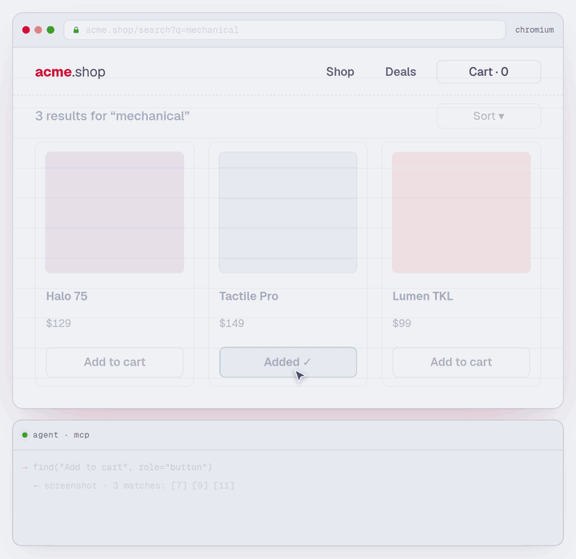

<p align="center">
  
</p>

<h1 align="center">BrowserControl</h1>

<p align="center">
  <b>Un navegador real para tu agente de IA. Ve la página y hace clic por número.</b>
</p>

<p align="center">
  <a href="https://pypi.org/project/browsercontrol/"></a>
  <a href="https://pypi.org/project/browsercontrol/"></a>
  <a href="https://github.com/adityasasidhar/browsercontrol/actions/workflows/ci.yml"></a>
  <a href="LICENSE"></a>
</p>

<p align="center">
  <a href="https://adityasasidhar.github.io/browsercontrol/"><b>Documentación</b> (en inglés)</a> ·
  <a href="https://adityasasidhar.github.io/browsercontrol/guide/quickstart">Inicio rápido</a> ·
  <a href="https://adityasasidhar.github.io/browsercontrol/reference/">Las 69 herramientas</a> ·
  <a href="https://adityasasidhar.github.io/browsercontrol/recipes/">Recetas</a> ·
  <a href="README.md">English</a>
</p>

---

BrowserControl es un servidor [MCP](https://modelcontextprotocol.io) que permite a Claude, Cursor, VS Code o cualquier otro cliente MCP usar un navegador Chromium real en tu equipo.

Después de cada acción, el agente recibe una captura de pantalla con **un recuadro numerado sobre cada botón, enlace y campo**, y la misma lista en texto. Para pulsar el botón marcado con el 5, llama a `click(5)`. Sin selectores CSS y sin adivinar coordenadas.

<p align="center">
  <picture>
    <source media="(prefers-color-scheme: dark)" srcset="https://raw.githubusercontent.com/adityasasidhar/browsercontrol/main/assets/demo-dark.gif">
    
  </picture>
</p>

## Instalación

Necesitas [uv](https://docs.astral.sh/uv/getting-started/installation/). Todo lo demás, incluido el navegador, se prepara en el primer arranque.

**Claude Code** (instala el servidor y una skill que le enseña a Claude a usarlo):

```text
/plugin marketplace add adityasasidhar/browsercontrol
/plugin install browsercontrol@browsercontrol
```

**VS Code o Cursor:** con un clic.

<a href="https://insiders.vscode.dev/redirect/mcp/install?name=browsercontrol&amp;config=%7B%22command%22%3A%22uvx%22%2C%22args%22%3A%5B%22browsercontrol%22%5D%7D"></a>
<a href="https://cursor.com/en/install-mcp?name=browsercontrol&amp;config=eyJjb21tYW5kIjoidXZ4IiwiYXJncyI6WyJicm93c2VyY29udHJvbCJdfQ%3D%3D"></a>

**Cualquier otro cliente:** añade esto a su configuración MCP.

```json
{
  "mcpServers": {
    "browsercontrol": {
      "command": "uvx",
      "args": ["browsercontrol"]
    }
  }
}
```

Reinicia el cliente y listo. La configuración para Claude Desktop, Gemini CLI, Zed, OpenCode y otros está en la [guía de clientes](https://adityasasidhar.github.io/browsercontrol/guide/clients).

## Pruébalo

Pídele a tu agente algo que necesite un navegador:

> Abre Hacker News y dime las tres noticias principales.

> Entra en mi app en localhost:3000, regístrate con una cuenta de prueba y dime si algo falla.

> Busca el vuelo más barato de Berlín a Lisboa para el próximo viernes y enséñame las opciones.

## Cómo funciona

Cada vez que el agente hace algo, BrowserControl espera a que la página se estabilice, hace una captura, numera todo lo que se puede usar y devuelve ambas cosas:

```text
Clicked element 5

Found 23 interactive elements:
  [1] a - Home
  [2] input[search] - Search products
  [3] button - Search
  [4] a - Sign in
  ...
```

El agente mira la imagen para entender la página y elige un número para su siguiente acción. Los números se rehacen después de cada paso, así que siempre coinciden con lo que hay en pantalla. Si algo se ha movido o ya no está, la herramienta lo dice en vez de hacer clic en lo que no es.

Esta técnica se llama [Set of Marks](https://adityasasidhar.github.io/browsercontrol/concepts/set-of-marks). Funciona en cualquier sitio, también en los que tienen un HTML desordenado, iframes o shadow DOM.

## Qué puede hacer tu agente

| | |
| --- | --- |
| **Navegar** | Abrir páginas, hacer clic, escribir, desplazarse, pasar el ratón, arrastrar y pulsar teclas. `find("Checkout")` busca en toda la página, no solo en lo visible. |
| **Agrupar pasos** | `act([...])` ejecuta varios pasos en una sola llamada y devuelve una sola captura, lo que ahorra tiempo y tokens. |
| **Rellenar formularios** | Elegir en desplegables, marcar casillas y subir archivos. |
| **Leer y extraer** | Obtener una página en Markdown, sacar tablas y enlaces, o extraer campos a JSON. |
| **Pestañas y sesiones** | Trabajar con varias pestañas, o abrir sesiones aisladas en paralelo, cada una con sus propias cookies. |
| **Depurar** | Leer los logs de la consola, los errores de la página y las peticiones de red con sus cabeceras y cuerpos. Exportar un archivo HAR. |
| **Probar casos límite** | Simular o bloquear respuestas de una API, ralentizar la red, quedarse sin conexión y emular móviles, ubicaciones, zonas horarias y el modo oscuro. |
| **Grabar** | Guardar trazas de Playwright y convertir lo que hizo el agente en un test de Playwright que se puede ejecutar. |

Consulta [las 69 herramientas](https://adityasasidhar.github.io/browsercontrol/reference/), con todos sus parámetros.

## Configuraciones habituales

**Verlo trabajar.** El navegador se ejecuta oculto por defecto. Para ver la ventana, define `BROWSER_HEADLESS`:

```json
"browsercontrol": {
  "command": "uvx",
  "args": ["browsercontrol"],
  "env": { "BROWSER_HEADLESS": "false" }
}
```

**Usar tu propio Chrome.** Abre Chrome con `--remote-debugging-port=9222` y pídele al agente que se conecte. Abre su propia pestaña y no toca las tuyas. [Cómo configurarlo](https://adityasasidhar.github.io/browsercontrol/recipes/your-chrome).

**Compartir un navegador entre clientes.** Ejecútalo como servidor HTTP y apunta tus clientes a `http://127.0.0.1:8000/mcp`:

```bash
uvx browsercontrol --transport http
uvx browsercontrol --transport http --isolate-clients   # una sesión separada por cliente
```

Todos los ajustes están en [Configuración](https://adityasasidhar.github.io/browsercontrol/reference/configuration).

## Conviene saber

- **Se ejecuta en local.** El navegador corre en tu equipo. Nada pasa por un servidor de BrowserControl.
- **Las sesiones se conservan.** El perfil del navegador está en `~/.browsercontrol/user_data`, así que los sitios donde inicias sesión siguen con la sesión abierta entre usos.
- **Está pensado para modelos con visión.** Cada acción devuelve una imagen. Eso le da al agente la imagen completa, pero gasta más tokens que las herramientas solo de texto. Mira [cómo se compara](https://adityasasidhar.github.io/browsercontrol/concepts/comparison) con otros enfoques.
- **El modo HTTP no tiene autenticación.** Mantenlo en `127.0.0.1` salvo que pongas algo delante.
- **¿Algo no funciona?** Revisa la [solución de problemas](https://adityasasidhar.github.io/browsercontrol/help/troubleshooting) o [abre un issue](https://github.com/adityasasidhar/browsercontrol/issues).

## Para agentes

La documentación también está pensada para que la lean agentes: [`llms.txt`](https://adityasasidhar.github.io/browsercontrol/llms.txt) enumera todas las páginas, [`llms-full.txt`](https://adityasasidhar.github.io/browsercontrol/llms-full.txt) las reúne en un solo archivo, y [`tools.json`](https://adityasasidhar.github.io/browsercontrol/tools.json) lista cada herramienta con sus parámetros. Cualquier página de la documentación está disponible en Markdown añadiendo `.md` a su dirección.

## Contribuir

Los informes de errores, las correcciones y las herramientas nuevas son bienvenidos.

```bash
git clone https://github.com/adityasasidhar/browsercontrol && cd browsercontrol
uv sync && uv run playwright install chromium
uv run pytest
```

La [guía de contribución](https://adityasasidhar.github.io/browsercontrol/project/contributing) explica las comprobaciones, cómo añadir una herramienta y cómo trabajar en la documentación. Lee también [CONTRIBUTING.md](CONTRIBUTING.md).

## Licencia

[MIT](LICENSE)
