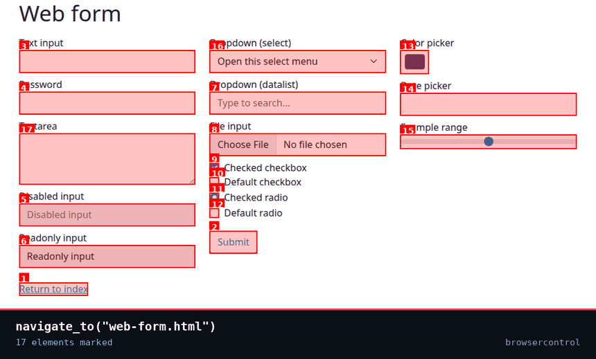

<p align="center">
  <a href="https://github.com/adityasasidhar/browsercontrol">
    
  </a>
</p>

# BrowserControl

[][docs]
[](https://pypi.org/project/browsercontrol/)
[](https://pypi.org/project/browsercontrol/)
[](https://github.com/adityasasidhar/browsercontrol/actions/workflows/ci.yml)
[](https://modelcontextprotocol.io)
[](https://playwright.dev/python/)
[](https://github.com/astral-sh/uv)
[](https://github.com/astral-sh/ruff)
[](https://mypy-lang.org/)
[](LICENSE)
[](https://pepy.tech/projects/browsercontrol)

[Español](README.es-ES.md)

## What is BrowserControl?

BrowserControl gives your AI client a local Chromium browser over the
[Model Context Protocol](https://modelcontextprotocol.io). Every action returns a
screenshot with numbered boxes over the page's controls, plus a matching text
list, so the agent acts by number (`click(5)`) instead of guessing CSS selectors.

<p align="center">
  
</p>

## Features

- 🎯 Vision-first control with [Set of Marks][som]: numbered elements on every screenshot, including iframes and shadow DOM
- 🧭 [Navigate and interact][interaction]: click, double-click, drag, type, and `find("text")` anywhere on the page
- ⚡ Run several steps in one call with `act(steps)` and get back a single screenshot
- 🔐 [Use your own browser][sessions]: attach to your running Chrome and its signed-in sites, or open isolated sessions
- 📝 [Fill forms][forms]: select options, check boxes, and upload local files
- 📖 [Read pages][content] as Markdown or text, and [extract data][extraction] as tables, links, or JSON fields
- 🌐 [Test real conditions][network]: mock or block requests, throttle the network, and emulate devices, locations, timezones, and dark mode
- 🐞 [Debug a web app][debug]: console logs, request headers and bodies, page errors, and HAR export
- 🎬 [Record a session][recording]: Playwright traces, snapshots, and export to a runnable Playwright test
- 🔌 Works with Claude Code, Cursor, VS Code, and any MCP client, over stdio or Streamable HTTP
- 🔒 Runs locally with a persistent profile, so logins survive restarts

### What's new

- 🔗 Attach to your own Chrome over CDP with `connect_to_chrome`; detaching never closes it
- 🧪 `export_test` turns an agent session into a pytest-playwright or `@playwright/test` file
- 💬 JS dialogs and downloads are handled automatically and reported in the next response
- ⏳ Smart settling after every action: load, network quiet, then DOM quiet
- 👥 Per-client isolated sessions with `--isolate-clients`

See the [changelog](CHANGELOG.md) for the full list.

## Quickstart

### 1. Install

You need [uv](https://docs.astral.sh/uv/getting-started/installation/) on your
`PATH`. In **Claude Code**, install the MCP server and the
[agent skill](skills/browsercontrol/SKILL.md) together as a plugin:

```text
/plugin marketplace add adityasasidhar/browsercontrol
/plugin install browsercontrol@browsercontrol
```

Then restart Claude Code or run `/reload-plugins`.

In **VS Code** or **Cursor**, install with one click:

<p>
  <a href="https://insiders.vscode.dev/redirect/mcp/install?name=browsercontrol&amp;config=%7B%22command%22%3A%22uvx%22%2C%22args%22%3A%5B%22browsercontrol%22%5D%7D"></a>
  <a href="https://insiders.vscode.dev/redirect/mcp/install?name=browsercontrol&amp;config=%7B%22command%22%3A%22uvx%22%2C%22args%22%3A%5B%22browsercontrol%22%5D%7D&amp;quality=insiders"></a>
  <a href="https://cursor.com/en/install-mcp?name=browsercontrol&amp;config=eyJjb21tYW5kIjoidXZ4IiwiYXJncyI6WyJicm93c2VyY29udHJvbCJdfQ%3D%3D"></a>
</p>

For **any other MCP client**, launch `uvx browsercontrol`. Clients that use
`mcpServers` JSON can merge in this entry:

```json
{
  "mcpServers": {
    "browsercontrol": {
      "command": "uvx",
      "args": ["browsercontrol"]
    }
  }
}
```

Or add it to Claude Code by hand:

```bash
claude mcp add --transport stdio browsercontrol -- uvx browsercontrol
```

Works on Linux, macOS, and Windows with Python 3.11+. On first launch,
BrowserControl reuses a compatible local browser or downloads Chromium.

More [client setup][connect] (Cursor, VS Code, and others) and
[installation options][installation] (pip, from source) are in the docs.

### 2. Ask your agent

Reload your client and try:

> Open Hacker News with BrowserControl and tell me the top story.

### 3. Share one browser (optional)

Serve over Streamable HTTP so several clients can use the same browser:

```bash
uvx browsercontrol --transport http                     # http://127.0.0.1:8000/mcp
uvx browsercontrol --transport http --isolate-clients   # one session per client
```

## How element numbers work

If a button is marked **5**, the agent calls `click(5)`. Every annotated
screenshot generates a fresh map, so **read the newest map before each action
that uses an ID**. If a control is off-screen, scroll to it, or let
`find("its text")` search the whole page and scroll there.

Read more in [Set of Marks][som].

## Documentation

Check out BrowserControl's [documentation][docs] for installation, concepts,
the [full tool reference][tools], [configuration][configuration], and
[troubleshooting][troubleshooting].

## Guides

Go hands-on with the [guides][guides]: [web research][guide-research],
[filling forms][guide-forms], [uploading files][guide-upload],
[multi-tab workflows][guide-tabs], [mobile and responsive testing][guide-mobile],
[debugging a web app][debug], and [recording tests][guide-record].

## Get help and support

Found a bug or have an idea? Open an
[issue](https://github.com/adityasasidhar/browsercontrol/issues).

## Contributing

```bash
uv sync
uv run playwright install chromium
uv run pytest
uv run --extra docs mkdocs serve
```

Please read the [development guide][development] and
[contribution guidelines](CONTRIBUTING.md) for details.

## License

BrowserControl is released under the [MIT license](LICENSE).

[docs]: https://adityasasidhar.github.io/browsercontrol/
[som]: https://adityasasidhar.github.io/browsercontrol/concepts/set-of-marks/
[interaction]: https://adityasasidhar.github.io/browsercontrol/tools/interaction/
[sessions]: https://adityasasidhar.github.io/browsercontrol/tools/sessions/
[forms]: https://adityasasidhar.github.io/browsercontrol/tools/forms/
[content]: https://adityasasidhar.github.io/browsercontrol/tools/content/
[extraction]: https://adityasasidhar.github.io/browsercontrol/tools/extraction/
[network]: https://adityasasidhar.github.io/browsercontrol/tools/network/
[recording]: https://adityasasidhar.github.io/browsercontrol/tools/recording/
[debug]: https://adityasasidhar.github.io/browsercontrol/guides/debug-web-app/
[tools]: https://adityasasidhar.github.io/browsercontrol/tools/
[configuration]: https://adityasasidhar.github.io/browsercontrol/configuration/
[troubleshooting]: https://adityasasidhar.github.io/browsercontrol/troubleshooting/
[connect]: https://adityasasidhar.github.io/browsercontrol/getting-started/connect-your-ai/
[installation]: https://adityasasidhar.github.io/browsercontrol/getting-started/installation/
[development]: https://adityasasidhar.github.io/browsercontrol/development/
[guides]: https://adityasasidhar.github.io/browsercontrol/guides/
[guide-research]: https://adityasasidhar.github.io/browsercontrol/guides/web-research/
[guide-forms]: https://adityasasidhar.github.io/browsercontrol/guides/fill-forms/
[guide-upload]: https://adityasasidhar.github.io/browsercontrol/guides/upload-files/
[guide-tabs]: https://adityasasidhar.github.io/browsercontrol/guides/multi-tab/
[guide-mobile]: https://adityasasidhar.github.io/browsercontrol/guides/mobile-responsive/
[guide-record]: https://adityasasidhar.github.io/browsercontrol/guides/record-tests/
