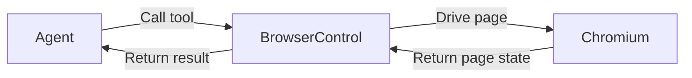

# Concepts

## How a tool call works

When the agent calls `click(5)`, BrowserControl resolves **5** from the active
tab’s latest element map and checks that the element is still in place.
After the click, it returns a new screenshot and element map for the next action.

- [Set of Marks](set-of-marks.md) explains what gets numbered and when IDs change.
- [Architecture](architecture.md) covers tool registration, browser state,
  and element resolution.
- [How it compares](comparison.md) describes other browser automation approaches.
