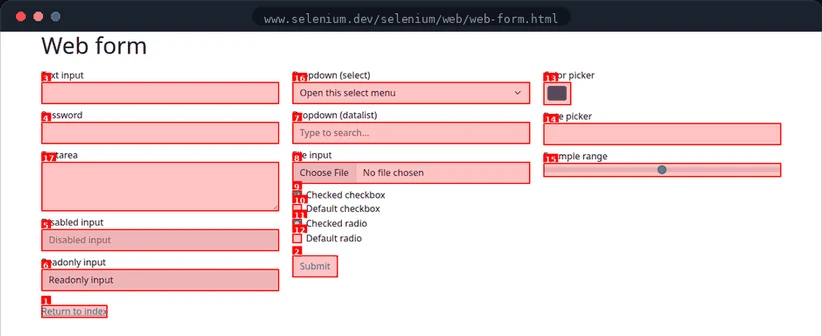

# Set of Marks (SoM)

BrowserControl draws numbered boxes around interactive controls in a screenshot
and returns the same numbers in a text list. This technique is called **Set of
Marks**. The agent uses the list and image together to choose its next action.

## What it looks like

{ width="822" height="336" }

The text input is marked **3** and Submit is marked **2**. An agent could call
`type_text(3, "Hello")`, then find Submit again in the new response before
calling `click`.

!!! tip "IDs belong to a screenshot and a tab"
    BrowserControl rebuilds the map whenever it takes an annotated screenshot.
    Read IDs from the latest response for the active tab.

## What gets numbered

- Visible links, buttons, form controls, and other detected click targets
  within the viewport.
- Controls inside open shadow roots and iframes, including cross-origin frames.
- Disabled controls, which are flagged in the map and drawn in gray.

Off-screen and covered controls are generally excluded. Styled checkbox,
radio, and file inputs can still be numbered when the input is transparent.

## How BrowserControl implements SoM

1. Detect interactive controls using markup and pointer behavior.
2. Collect controls from each frame and open shadow root, then filter by visibility.
3. Assign each control a temporary `data-bc-id` and draw its number on the screenshot.
4. Return the screenshot and the corresponding element map.

## Resolution: number → element

When the agent calls `click(5)`, BrowserControl finds element 5 again by its `data-bc-id`, using a locator scoped to the frame it was found in. Playwright's CSS locators pierce open shadow roots, so the click reaches the numbered element itself, whether it sits in a shadow root, an iframe, or the main document.

Before acting, it checks that the element is still there and still where the screenshot showed it. If it was removed, hidden, or moved by more than a few pixels, the tool doesn't act. It returns `Element 5 is stale (...)` with a fresh screenshot. Element maps are kept per tab, so IDs from one tab never resolve against another.

## Find controls on crowded pages

For pages with hundreds of interactive elements (search results, infinite-scroll feeds), the element map gets crowded, and the control you want may not be on screen at all. Strategies:

- **Search instead of scanning** — [`find("Add to cart")`](../tools/navigation.md#find) searches the whole page, off-screen content, iframes, and shadow DOM included, scrolls to the match, and returns its ID in the new map. Add `role="button"` to skip matching text that isn't a control.
- **Scroll** — call `scroll(direction)` to bring a different part of the page into view, and read the new map returned by the tool.
- **Batch steps** — once you have the IDs you need, [`act`](../tools/interaction.md#act) runs several actions against the same map in one call.
- **Extract instead of reading** — [`extract_table`, `extract_links`, or `extract`](../tools/extraction.md) return structured data without picking elements from a noisy screenshot.

## See also

- **[Architecture](architecture.md)** — how SoM fits into the action loop
- [Original SoM paper](https://arxiv.org/abs/2304.08242) — the research behind the technique
