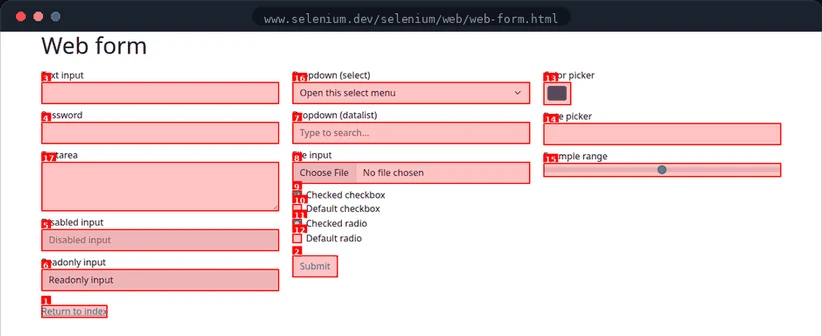

# Run your first session

After [connecting your client](connect-your-ai.md), use Selenium’s public demo
form to see how BrowserControl reads a page and acts on it. Use sample data for
this exercise.

## Open the form

Ask your agent:

> Open https://www.selenium.dev/selenium/web/web-form.html with BrowserControl.
> Tell me the element numbers for the text input and the Submit button.

The agent calls `navigate_to`. BrowserControl returns an annotated screenshot
and a text list with the same element IDs.

<figure class="bc-example" markdown>

{ width="822" height="336" }

<figcaption>Example response. Read the actual IDs from your session.</figcaption>

</figure>

## Fill and submit

Ask your agent:

> Enter “BrowserControl demo” in the text input, then submit the form.
> Confirm that the next page says “Form submitted”.

1. The agent reads the current text input ID and calls `type_text`.
2. It reads the returned element map, finds the **current** Submit button ID,
   and calls `click`.
3. It verifies the confirmation using the returned screenshot or
   [`get_page_content()`](../tools/content.md#get_page_content).

!!! tip "Read the newest element map before acting"
    Every annotated screenshot rebuilds the IDs. Even if the form looks the
    same after typing, look up Submit in the new response before using its ID.

## Try a different task

- [Fill a form with dropdowns and checkboxes](../guides/fill-forms.md).
- [Inspect console and network activity](../guides/debug-web-app.md).
- [Capture a Playwright trace](../guides/record-tests.md).
