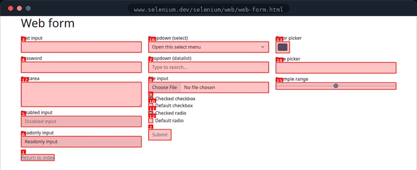

---
hide:
  - navigation
  - toc
  - footer
---

<section class="bc-hero" markdown>

# Browser automation for AI agents

BrowserControl is a local MCP server that gives your AI client a Chromium browser.
It numbers controls in screenshots so your agent can click, type, and navigate
using the page it sees.

[Get started](getting-started/index.md){ .md-button .md-button--primary }
[Browse tools](tools/index.md){ .md-button }

<figure class="bc-example" markdown>

{ width="822" height="336" }

<figcaption markdown>

BrowserControl marks the form’s controls. In this screenshot, `click(2)` presses Submit.

</figcaption>
</figure>

</section>

## Set up BrowserControl

-   **1. [Install](getting-started/installation.md)**

    Install the server. It finds a compatible browser or downloads Chromium on first launch.

-   **2. [Connect an MCP client](getting-started/connect-your-ai.md)**

    Add BrowserControl to Claude, Cursor, VS Code, or another client with stdio support.

-   **3. [Run your first session](getting-started/first-session.md)**

    Ask your agent to fill a demo form and check the result.

## Find what you need

-   :material-book-open-variant-outline: **[Tool reference](tools/index.md)**

    Look up tool arguments, defaults, and examples.

-   :material-map-outline: **[Guides](guides/index.md)**

    Fill forms, inspect network requests, and record a browser session.

-   :material-eye-outline: **[Set of Marks](concepts/set-of-marks.md)**

    Learn how element numbers work and when they change.

-   :material-cog-outline: **[Configuration](configuration.md)**

    Set the viewport, browser profile, and recording paths.

[Fix setup or browser issues](troubleshooting.md)
